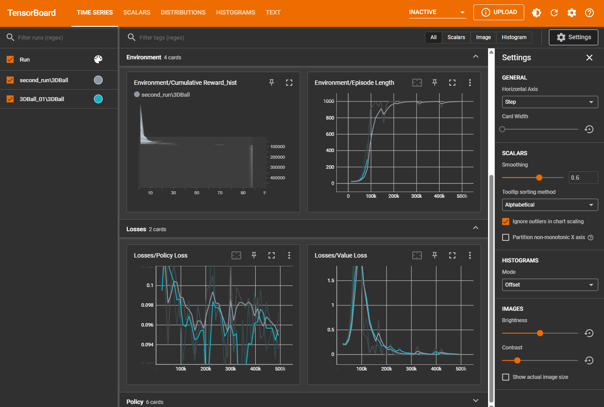

# Unity ML-Agents 3DBall

A small Reinforcement Learning project where I trained an AI agent to balance a ball on a platform using Unity ML-Agents and PPO.

I used the 3DBall environment to understand how an RL agent observes its environment, takes actions, receives rewards, and learns from repeated attempts.

## 1. What is this project?

The goal is simple: **keep the ball on the platform for as long as possible.**

The agent controls the platform's tilt to prevent the ball from falling. Initially, its actions aren't very good, but through training, it learns a policy that helps it balance the ball more effectively.

This project helped me understand the basic workflow of reinforcement learning, from configuring the environment to training and evaluating a model.

## 2. How the agent works

The agent follows a simple loop:

`Observe → Take Action → Receive Reward → Learn → Repeat`

### Observations

The agent receives 8 numerical observations describing the platform and the ball.

| Observation | Values |
|---|---:|
| Platform rotation around the Z axis | 1 |
| Platform rotation around the X axis | 1 |
| Ball's relative position (X, Y, Z) | 3 |
| Ball's linear velocity (X, Y, Z) | 3 |
| **Total** | **8** |

These observations help the agent understand the ball's position and movement so it can decide how to tilt the platform.

### Actions

The agent has 2 continuous actions:

- **Action 0:** Controls rotation around the Z axis.
- **Action 1:** Controls rotation around the X axis.

The action values are clipped to the range `-1 to +1` and multiplied by `2` before being applied as rotation increments.

### Reward and episode termination

The agent's reward is handled in the `OnActionReceived()` method.

- `SetReward(0.1f)` is called when the ball stays within the allowed region.
- `SetReward(-1f)` is called when the ball falls too low or moves too far away from the platform.
- `EndEpisode()` terminates the episode when the ball fails.

The maximum episode length is 5,000 steps.

### An important observation about rewards

Initially, I expected a perfect episode to earn a cumulative reward of 500, based on `5000 × 0.1`.

However, the TensorBoard results showed the reward plateauing around **100**.

The reason is the difference between `SetReward()` and `AddReward()`.

- `SetReward(0.1f)` replaces the current reward with `0.1` instead of accumulating another `0.1`.
- `AddReward(0.1f)` adds `0.1` to the existing reward.

With a Decision Period of 5, repeated calls to `SetReward(0.1f)` overwrite the previous reward rather than accumulating five separate rewards.

Therefore, the approximate maximum reward becomes:

`5000 / 5 × 0.1 = 100`

This matches the plateau observed during training.

If I switch to `AddReward(0.1f)` on every successful step, the reward structure changes, potentially allowing a cumulative reward of 500 for a perfect 5,000-step episode. However, this would also change the scale of the rewards used during training.

## 3. Training configuration

I trained the agent using **Proximal Policy Optimization (PPO)** through Unity ML-Agents.

The main settings were:

| Parameter | Value | Purpose |
|---|---:|---|
| Algorithm | PPO | Updates the agent's policy |
| Buffer size | 12,000 | Experiences collected before a policy update |
| Batch size | 64 | Experiences processed per minibatch |
| Number of epochs | 3 | Passes over the collected data |
| Epsilon | 0.2 | Controls clipping in PPO's surrogate objective |
| Gamma | 0.99 | Discount factor for future rewards |
| Max Step | 5,000 | Maximum steps per episode |
| Decision Period | 5 | Makes a new decision every five steps |
| Parallel environments | 12 | Runs multiple environment instances simultaneously |

The 12 platform instances generate experiences in parallel. This helps the trainer collect more varied experiences without relying entirely on consecutive interactions from a single environment.

### Why PPO?

PPO allows the agent to learn from collected experiences over multiple epochs while using a clipped objective to discourage excessively large policy updates.

With a buffer size of 12,000, batch size of 64, and 3 epochs, the trainer reuses the collected data across multiple minibatches before collecting fresh experience for the next update.

The `epsilon: 0.2` setting gives a probability-ratio clipping range of `0.8 to 1.2`.

This helps control policy updates, although clipping does not guarantee a strict 20% limit on every policy probability change.

## 4. Understanding the training results

I used TensorBoard to monitor the training process.

The main results I observed were:

- **Cumulative reward:** Increased during training and eventually plateaued around 100.
- **Training progress:** The reward reached approximately 100 at around 200k training steps.
- **Episode length:** Increased as the agent learned to keep the ball on the platform for longer.

### TensorBoard results



The reward plateau is consistent with the reward-handling logic in my script and the five-step Decision Period.

It is important to distinguish between the reward plateau and the total number of training steps: the former describes the agent's observed performance, while the latter describes how much training has taken place.

## 5. Understanding PPO clipping and reward scaling

One thing I learned while studying PPO is that the agent doesn't simply optimize the undiscounted sum of rewards.

With `gamma: 0.99`, future rewards are discounted. For an indefinitely continuing stream of reward `r`, the approximate discounted return is:

`Return ≈ r / (1 - gamma)`

For the current reward structure, assuming a reward of `0.1` per decision interval:

`0.1 / (1 - 0.99) = 10`

If I switch to `AddReward(0.1f)` and accumulate five successful rewards per interval, the reward becomes `0.5` per interval:

`0.5 / (1 - 0.99) = 50`

These are simplified estimates, not the exact returns of a finite episode.

The change increases the reward scale by a factor of five. PPO's advantage normalization can reduce the direct effect of reward scaling on policy updates, but the value function still needs to predict the larger returns.

Because value loss depends on prediction errors, the `AddReward()` experiment could produce larger value-loss spikes. I would need to compare the training curves before concluding whether it improves learning speed or stability.

## 6. Trained model

The trained ONNX model is included in the `results/` directory.

```text
results/
└── 3DBall.onnx
```

The model can be assigned to the appropriate Unity ML-Agents Behavior Parameters configuration for inference.

The exact model filename and location may differ depending on which training run was completed.

## 7. Project structure

```text
unity-mlagents-3dball/
│
├── README.md
│
├── config/
│   └── 3DBall.yaml
│
├── results/
│   └── 3DBall.onnx
│
└── screenshots/
    └── 
```

## 8. What I learned

Working on this project helped me understand:

- How observations and continuous actions work in reinforcement learning.
- How reward functions influence an agent's behavior.
- How episode length and decision frequency affect interaction with the environment.
- Why multiple environment instances are useful during training.
- How PPO uses minibatches, multiple epochs, and clipping.
- How the discount factor affects the value of future rewards.
- How to monitor training through TensorBoard.
- How to export and use a trained model in ONNX format.
- Why understanding reward bookkeeping matters when interpreting training results.

## 9. What's next?

Some things I want to explore further:

- Experimenting with `SetReward()` versus `AddReward()`.
- Comparing training curves under different reward structures.
- Investigating how reward scaling affects value loss and training stability.
- Testing different PPO settings.
- Building a custom Unity environment and training an agent from scratch.

This is my starting point for exploring reinforcement learning in Unity, and I plan to build on these concepts in future projects.

---

**Tech stack:** Unity · C# · Unity ML-Agents · Python · PPO · TensorBoard · ONNX
